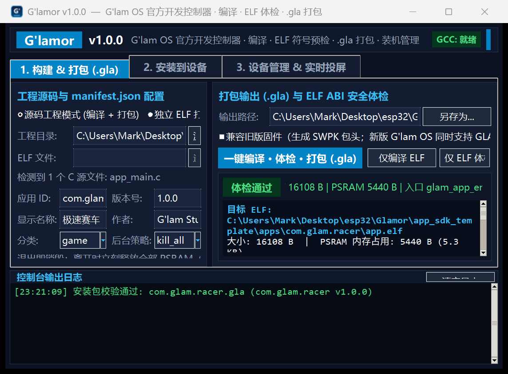

# G'lamor — Zero-Environment PC Controller & C/ELF SDK for G'lam OS

<p align="center">
  <b>G'lam OS 官方零环境开发控制器 · C/ELF 动态应用 SDK · PC 端 17 符号 ABI 静态体检 · <code>.gla</code> 打包与热装机工作台</b><br>
  <b>Official Zero-Environment PC Controller, C/ELF App SDK, ABI Preflight Auditor &amp; <code>.gla</code> Packager</b><br><br>
  <a href="#中文开发者手册">中文开发者手册</a> &nbsp;|&nbsp; <a href="#english-developer-guide">English Developer Guide</a> &nbsp;|&nbsp;
  <a href="https://github.com/mark3268867477-spec/Glam-OS">配套 OS 内核仓库 (Glam-OS)</a>
</p>

<p align="center">
  
</p>

---

<a id="中文开发者手册"></a>
# 中文开发者手册

> **配套操作系统固件仓库**：  
> 本项目是 **[G'lam OS (`mark3268867477-spec/Glam-OS`)](https://github.com/mark3268867477-spec/Glam-OS)** 的配套电脑端开发控制器与第三方应用 SDK。  
> 欲了解 ESP32-S3 系统内核、PSRAM ELF32 双总线加载器与硬件引脚定义，请访问 **[mark3268867477-spec/Glam-OS](https://github.com/mark3268867477-spec/Glam-OS)**。

---

## 目录

1. [技术背景：G'lamor 如何打通动态应用开发闭环](#一-技术背景glamor-如何打通动态应用开发闭环)
2. [零环境快速上手（免 Python / 免 ESP-IDF）](#二-零环境快速上手免-python--免-esp-idf)
3. [应用工程目录结构（支持多文件编译）](#三-应用工程目录结构支持多文件编译)
4. [`manifest.json` 配置规范与三级后台策略](#四-manifestjson-配置规范与三级后台策略)
5. [`glam_os_api.h` (ABI v1) 完整 C 接口手册](#五-glam_os_apih-abi-v1-完整-c-接口手册)
6. [内核 17 项导出符号白名单与外设调用](#六-内核-17-项导出符号白名单与外设调用)
7. [`.gla` 二进制安装包格式规范](#七-gla-二进制安装包格式规范)
8. [`glamctl` 命令行参考与 Makefile / CI 集成](#八-glamctl-命令行参考与-makefile--ci-集成)
9. [常见报错排查与性能红线](#九-常见报错排查与性能红线)

---

## 一、 技术背景：G'lamor 如何打通动态应用开发闭环

在 **[G'lam OS](https://github.com/mark3268867477-spec/Glam-OS)** 中，应用与操作系统内核在物理存储与链接空间上完全解耦：所有第三方应用均编译为可重定位 **Xtensa ELF32 (`app.elf`)**，打包为 **`.gla`** 安装包后写入外部 TF 卡，由内核动态加载至 **8MB Octal PSRAM**（`DBUS 0x3C` / `IBUS 0x42`）以原生机器码运行。

这一架构对 PC 端构建提出了三项严格要求：
1. **交叉编译工具链**：需要 `xtensa-esp32s3-elf-gcc`，完整 ESP-IDF 环境体积庞大且配置繁琐；
2. **跨内存区链接约束**：PSRAM (`0x42xxxxxx`) 与内核 Flash/IRAM (`0x403xxxxx`) 跨区调用距离超过 512KB，编译必须强制启用 `-mlongcalls` 与 `-mtext-section-literals`，链接必须使用基址为 `0x0` 的 `glam_app.ld` 并保留 `-Wl,-q` 重定位表；
3. **链接前符号审计**：因动态应用链接内核符号时开启了 `--unresolved-symbols=ignore-all`，若开发者误用了未导出的标准库函数（如 `printf`、`malloc`、`fopen`），常规构建不会在编译期报错，而是推上设备后被内核加载器拒绝。

**G'lamor** 将上述技术复杂度全部封装进一个 **38 MB 的零环境 Windows 64 位绿色压缩包**：
* **内置完整便携工具链**：集成精简版 `xtensa-esp32s3-elf-gcc` (14.2.0) 与独立 Python 3.13 / Tk 运行时，无需在宿主机安装任何环境即可直接运行；
* **PC 端 ELF ABI 静态预检 (`elf_check.py`)**：在打包阶段直接解析 ELF32 节表、重定位表与未定义符号，对照内核 **17 项安全白名单** 拦截短调用与非法符号；
* **一键 `.gla` 打包 + 三通道热安装 + 320×240 实时抓屏监控**。

---

## 二、 零环境快速上手（免 Python / 免 ESP-IDF）

### 第 1 步：下载并启动 G'lamor
* 前往 **[GitHub Releases](https://github.com/mark3268867477-spec/Glamor/releases/latest)** 下载 `Glamor_v1.0.0_Win64_Portable.zip`，解压至任意目录；
* 双击 **`G'lamor.exe`**（源码仓库用户可双击 `启动_Glamor.bat`），顶部状态栏显示绿色 **`GCC: 就绪`** 即表示内置交叉编译器挂载成功。

### 第 2 步：新建工程并用任意外部编辑器编写 `.c`
1. 点击右上角 **「新建应用」**，填写反向域名格式的应用 ID（如 `com.dev.hello`）、显示名称、应用分类与主题色，生成标准工程模板；
2. 使用任意熟悉的编辑器（**VS Code、CLion、Dev-C++、Notepad++** 等）打开 `app_main.c` 编写逻辑。**只需保存 `.c` 源文件，不要在外部编辑器中自行编译。**

### 第 3 步：一键编译、ABI 体检并打包 `.gla`
回到 **G'lamor** 的 **「1. 构建 & 打包 (.gla)」** 页：
1. 可选点击 **「选择图标 (PNG/JPG)」** 替换应用图标（打包器自动居中裁剪并编码为 `40×40` Baseline JPEG 内嵌至包头）；
2. 点击 **「一键编译 · 体检 · 打包 (.gla)」**，右侧 **ELF ABI 安全体检面板** 实时输出体检结果、ELF 体积、预计 PSRAM 占用、入口符号 `glam_app_entry` 与重定位节数量，并生成 `<app_id>.gla`。

### 第 4 步：三通道免刷机热安装到设备
切换到 **「2. 安装到设备」** 页，任选以下一种通道直接写入设备 TF 卡 `/sdcard/apps/<app_id>/`（**绝不擦写片内 Flash、无需重启设备**）：
1. **Wi-Fi 无线推送（推荐）**：填入设备局域网 IP（如 `192.168.1.50`）点击安装，或点击 **「打开网页端」** 在浏览器中上传 `.gla`；
2. **USB 串口热推**：设备正常开机连接 USB 数据线，选择串口（如 `COM7`）点击推送安装；
3. **TF 卡离线直写**：插上读卡器选择盘符直接解包写入，或将 `.gla` 拷入 TF 卡 `/install/` 后在设备端一键安装。

### 第 5 步：设备资源监控与真机实时投屏
在 **「3. 设备管理 & 实时投屏」** 页输入设备 IP，可实时查询设备 PSRAM / SRAM 剩余水位、远程卸载已安装应用，并抓取 320×240 真机画面或开启 2 秒定时自动刷新预览。

---

## 三、 应用工程目录结构（支持多文件编译）

G'lamor 自动扫描工程根目录与 `src/` 子目录下的全部 `.c` 文件，并自动将工程根目录、`include/`、`src/` 及 SDK `include/` 加入头文件搜索路径：

```text
com.example.myapp/
 ├── manifest.json        # [必填] 应用元数据、分类与后台生命周期策略
 ├── icon.png             # [可选] 自定义图标 (自动转 40x40 Baseline JPEG)
 ├── app_main.c           # [必填] 应用主源码（定义 glam_app_entry 入口）
 ├── include/             # [可选] 工程私有头文件 (.h)
 │    └── game_logic.h
 └── src/                 # [可选] 多模块拆分源码 (.c)，编译时自动合并链接
      └── game_logic.c
```

---

## 四、 `manifest.json` 配置规范与三级后台策略

```json
{
  "id": "com.example.myapp",
  "name": "示例应用",
  "version": "1.0.0",
  "api_level": 1,
  "entry": "app.elf",
  "category": "tool",
  "bg_policy": "keep_all",
  "author": "Developer",
  "accent": "#0EA5E9",
  "description": "应用功能简述",
  "permissions": ["sandbox_data"]
}
```

| 字段名 | 类型 | 必填 | 约束说明 |
| :--- | :--- | :---: | :--- |
| `id` | String | 是 | 唯一反向域名标识，仅允许 `a-zA-Z0-9._-`，禁含 `..`，UTF-8 `< 64B` |
| `name` | String | 是 | 桌面磁贴与后台列表显示名称，UTF-8 `< 64B` |
| `version` | String | 是 | 语义化版本号（如 `"1.0.0"`），`< 16B` |
| `api_level` | Number | 是 | 固定 `1`（对应 `GLAM_OS_API_VERSION = 1`） |
| `entry` | String | 是 | 固定 `"app.elf"` |
| `category` | String | 是 | `"game"` \| `"media"` \| `"service"` \| `"tool"` \| `"system"` |
| `bg_policy` | String | 推荐 | `"kill_all"` \| `"partial_service"` \| `"keep_all"` |
| `accent` | String | 否 | 主题色 `"#RRGGBB"`（默认 `"#3B82F6"`） |
| `permissions` | Array | 否 | 可选 `"sandbox_data"`、`"audio"`、`"media_read"` |

### 三级后台生命周期策略 (`bg_policy`)
| 策略值 | 默认适用分类 | 返回桌面时的系统行为 |
| :--- | :--- | :--- |
| **`"kill_all"`** | `"game"`, `"system"` | 立即调用 `on_destroy()` 并释放全部 PSRAM，不在后台驻留 |
| **`"partial_service"`** | `"media"`, `"service"` | 释放前台 UI 控件，仅在音频播放或倒计时进行中保留后台服务槽位 |
| **`"keep_all"`** | `"tool"` | 完整保留 PSRAM 现场并**自动冻结全部应用定时器（后台 0% CPU 占用）**，切回时 **0 秒恢复** |

---

## 五、 `glam_os_api.h` (ABI v1) 完整 C 接口手册

* **屏幕与视口常量**：`GLAM_SCREEN_W = 320`、`GLAM_SCREEN_H = 240`、顶部系统状态栏 `GLAM_STATUSBAR_H = 24`；传入 `on_create()` 的 `root` 视口尺寸为 **`320×216`**。
* **最小可运行 C 模板**：

```c
#include "glam_os_api.h"

static const glam_os_api_t *s_os = NULL;
static glam_obj_t s_lbl = NULL;
static glam_timer_t s_timer = NULL;
static uint32_t s_ticks = 0;

static void on_btn_click(void *user_data) {
    (void)user_data;
    s_ticks++;
    char buf[64];
    s_os->fmt_snprintf(buf, sizeof(buf), "点击次数: %u", (unsigned)s_ticks);
    s_os->ui_set_label_text(s_lbl, buf);
    s_os->show_toast("已触发按钮点击!");
}

static void on_exit_click(void *user_data) {
    (void)user_data;
    s_os->request_exit();
}

static void on_timer_tick(void *user_data) {
    (void)user_data;
}

static int app_on_create(const glam_os_api_t *os, glam_obj_t root, const char *app_id, const char *data_dir) {
    (void)app_id; (void)data_dir;
    s_os = os;
    s_ticks = 0;
    os->ui_clear_root(root, 0x0B1120U);
    glam_obj_t card = os->ui_create_panel(root, 8, 8, 304, 200, 0x131C31U, 12, 0x0EA5E9U);
    os->ui_create_label(card, "Hello G'lam OS!", 14, 12, 0xF8FAFCU, 16);
    s_lbl = os->ui_create_label(card, "点击次数: 0", 14, 48, 0x38BDF8U, 14);
    os->ui_create_button(card, "点我 +1", 14, 146, 132, 38, 0x0284C7U, on_btn_click, NULL);
    os->ui_create_button(card, "退出应用", 158, 146, 132, 38, 0x334155U, on_exit_click, NULL);
    s_timer = os->ui_create_timer(on_timer_tick, 1000, NULL);
    return 0;
}

static void app_on_destroy(void) {
    if (s_timer && s_os) {
        s_os->ui_delete_timer(s_timer);
        s_timer = NULL;
    }
}

static const glam_app_desc_t s_desc = {
    .on_create  = app_on_create,
    .on_destroy = app_on_destroy,
};

const glam_app_desc_t *glam_app_entry(void) {
    return &s_desc;
}
```

### `glam_os_api_t` 接口分类速查表
| 分类 | 接口签名 | 说明 |
| :--- | :--- | :--- |
| **系统与内存** | `api_version` | 内核 ABI 版本号（恒为 `1`） |
| | `void (*log_info)(const char *tag, const char *fmt, ...)` | 串口调试日志（替代 `printf`） |
| | `void (*show_toast)(const char *msg)` | 底部 2.4 秒全局悬浮提示 |
| | `void (*request_exit)(void)` | 主动退出并销毁当前应用 |
| | `uint32_t (*get_free_psram)(void)` / `(*get_free_sram)(void)` | 查询剩余 PSRAM / SRAM 字节数 |
| | `void *(*malloc_psram)(size_t size)` / `(*free_psram)(void *ptr)` | PSRAM 动态内存分配与释放 |
| | `int (*fmt_snprintf)(char *buf, size_t size, const char *fmt, ...)` | 安全字符串格式化 |
| **安全 UI 控件** | `void (*ui_clear_root)(glam_obj_t root, uint32_t bg_hex)` | 清空并设置 `320×216` 背景色 |
| | `glam_obj_t (*ui_create_panel)(parent, x, y, w, h, bg_hex, radius, border_hex)` | 创建圆角卡片容器 |
| | `glam_obj_t (*ui_create_label)(parent, text, x, y, color_hex, font_size)` | 文本标签（含中文自动切换 14px CJK 字库） |
| | `void (*ui_set_label_text)(label, text)` / `(*ui_set_label_color)(label, color)` | 动态更新标签文本与颜色 |
| | `glam_obj_t (*ui_create_button)(parent, text, x, y, w, h, bg_hex, cb, user_data)` | 创建按钮并绑定点击回调 |
| | `glam_obj_t (*ui_create_bar)(parent, x, y, w, h, min_v, max_v, bg_hex, ind_hex)` | 创建进度条 + `ui_set_bar_value(bar, val)` |
| | `glam_obj_t (*ui_create_list)(parent, x, y, w, h, bg_hex)` | 创建滚动列表 + `ui_list_add_btn(...)` |
| | `glam_timer_t (*ui_create_timer)(cb, period_ms, user_data)` / `(*ui_delete_timer)(t)` | 主线程周期定时器（`keep_all` 切后台自动暂停） |
| **沙盒存储** | `int (*storage_write_text)(app_id, rel_name, content)` | 写入 `/sdcard/data/<app_id>/<rel_name>` |
| | `int (*storage_read_text)(app_id, rel_name, out_buf, max_len)` | 读取沙盒文件（不存在返回 `-1`） |
| **音频与外设** | `audio_play_file` / `pause` / `resume` / `stop` / `is_playing` / `set_volume` / `scan_music` | 后台音频播放控制与 `/sdcard/music/` 扫描 |
| | `wifi_is_connected` / `wifi_get_ip` / `sd_is_mounted` | 查询网络状态、IP 与 TF 卡挂载 |

---

## 六、 内核 17 项导出符号白名单与外设调用

| 类别 | 允许 `.elf` 直接重定位的 17 个外部符号 |
| :--- | :--- |
| **基础内存与字符串 (8)** | `memcpy`, `memset`, `memmove`, `memcmp`, `strlen`, `strcmp`, `strncmp`, `snprintf` |
| **I2C 传感器总线 (5)** | `bsp_i2c_get_handle`, `i2c_master_bus_add_device`, `i2c_master_bus_rm_device`, `i2c_master_transmit`, `i2c_master_transmit_receive` |
| **LVGL 高频渲染辅助 (4)** | `lv_obj_set_pos`, `lv_obj_set_style_bg_color`, `lv_obj_add_flag`, `lv_obj_clear_flag` |

* 传感器与动画实战可参考 `app_sdk_template/apps/com.glam.racer/app_main.c`（通过上述 I2C 与 LVGL 白名单符号直接驱动板载 **QMI8658 六轴陀螺仪**）。
* 严禁调用 `printf`、`malloc`、`free`、`fopen`，请分别替换为 `os->log_info`、`os->malloc_psram`、`os->free_psram`、`os->storage_*_text`。

---

## 七、 `.gla` 二进制安装包格式规范

`160 字节定长 Header (<4sHHII64s64s16s) + manifest_bytes + elf_bytes`：
* `0x00 (4B)`：`magic` = `"GLAM"`（兼容旧版 `"SWPK"`）
* `0x04 (2B)`：`version` = `1`；`0x06 (2B)`：`header_len`（JSON 长度）
* `0x08 (4B)`：`elf_size`；`0x0C (4B)`：`crc32`（对 `manifest_bytes + elf_bytes` 计算 IEEE 802.3 CRC32）
* `0x10 (64B)`：`app_id`；`0x50 (64B)`：`app_name`；`0x90 (16B)`：`app_version`

---

## 八、 `glamctl` 命令行参考与 Makefile / CI 集成

```cmd
glamctl.exe devices
glamctl.exe init my_apps\com.dev.demo --id com.dev.demo --name "示例工具" --category tool --accent #0EA5E9
glamctl.exe build my_apps\com.dev.demo
glamctl.exe check my_apps\com.dev.demo\app.elf
glamctl.exe pack my_apps\com.dev.demo --build --out dist\com.dev.demo.gla
glamctl.exe verify dist\com.dev.demo.gla
glamctl.exe install dist\com.dev.demo.gla --wifi 192.168.1.50
glamctl.exe install dist\com.dev.demo.gla --port COM7
glamctl.exe screenshot --wifi 192.168.1.50 --out screen.bmp
```

手动 Makefile 必须携带的编译链接参数：
```makefile
CFLAGS  = -mlongcalls -mtext-section-literals -fno-common -ffunction-sections -fdata-sections -O2 -Wall -Wextra -I<sdk>/include
LDFLAGS = -nostdlib -Wl,-T,<sdk>/ld/glam_app.ld -Wl,-q -Wl,--gc-sections -Wl,--unresolved-symbols=ignore-all -lgcc
```

---

## 九、 常见报错排查与性能红线

1. **违规符号拦截**：使用 `printf` / `malloc` / `sinf` 会被 `elf_check.py` 拦截，请改用 `os->log_info`、`os->malloc_psram` 或在源码内实现轻量辅助函数。
2. **`R_XTENSA_SLOT0_OP` 短调用报错**：因应用运行在 PSRAM (`0x42xxxxxx`) 而内核在 Flash/IRAM (`0x403xxxxx`)，跨区调用必须加 `-mlongcalls`。
3. **缺少重定位表**：链接时必须带 `-Wl,-q` 保留 `SHT_RELA`。
4. **UI 线程不卡顿红线**：`ui_create_timer` 回调运行在 LVGL 主线程，**单次耗时不得超过 `10 ms`**，严禁阻塞操作或 `vTaskDelay`。

---
---

<a id="english-developer-guide"></a>
# English Developer Guide

> **Companion OS Firmware Repository**:  
> **G'lamor** is the official zero-environment PC controller and C/ELF App SDK for **[G'lam OS (`mark3268867477-spec/Glam-OS`)](https://github.com/mark3268867477-spec/Glam-OS)**.  
> For the ESP32-S3 kernel source, PSRAM ELF32 dual-bus loader, and hardware pinouts, visit **[mark3268867477-spec/Glam-OS](https://github.com/mark3268867477-spec/Glam-OS)**.

---

## 1. Technical Overview

On **[G'lam OS](https://github.com/mark3268867477-spec/Glam-OS)**, applications are decoupled from the internal Flash kernel: third-party programs are compiled into relocatable **Xtensa ELF32 (`app.elf`)** binaries, packaged into **`.gla`** archives on the external TF card, and dynamically loaded into **8MB Octal PSRAM** (`DBUS 0x3Cxxxxxx` / `IBUS 0x42xxxxxx`) to execute as native machine code with zero Flash wear and no device reboot.

**G'lamor** packages the complete cross-compilation and verification pipeline into a **38 MB portable Windows x64 bundle**:
* **Embedded Toolchain & Runtime**: Ships with a slim `xtensa-esp32s3-elf-gcc` (14.2.0) and Python 3.13 / Tk runtime—no Python or ESP-IDF installation required;
* **PC-Side 17-Symbol ABI Preflight Checker (`elf_check.py`)**: Inspects ELF32 relocation sections and undefined symbols on the host before packaging, blocking short-call relocations (`R_XTENSA_SLOT0_OP`) and unexported libc calls (`printf`, `malloc`, `fopen`);
* **`.gla` Packager + Triple-Channel Hot Installer + 320×240 Framebuffer Capture**.

---

## 2. Zero-Environment Quick Start

1. **Download & Launch**: Download `Glamor_v1.0.0_Win64_Portable.zip` from **[GitHub Releases](https://github.com/mark3268867477-spec/Glamor/releases/latest)**, extract, and run **`G'lamor.exe`**. Confirm the top-right status badge shows **`GCC: 就绪`** (GCC Ready).
2. **Create & Edit**: Click **New App**, enter a reverse-domain ID (e.g. `com.dev.hello`), display name, category, and accent color. Edit `app_main.c` in any external editor (VS Code, CLion, Notepad++) and save—do not compile inside the external editor.
3. **Build, Audit & Pack (`.gla`)**: Click **Build · Check · Pack (`.gla`)** in Tab 1. G'lamor compiles all `.c` sources, runs the 17-symbol ABI preflight check, embeds a `40×40` Baseline JPEG icon, and outputs `<app_id>.gla`.
4. **Hot-Install to Device (Tab 2)**: Deploy via **Wi-Fi HTTP**, **USB Serial (`COMx`)**, or **TF Card Direct Write**. No SPI Flash erase and no reboot required.
5. **Telemetry & Screen Capture (Tab 3)**: Monitor free PSRAM/SRAM, remotely uninstall apps, and capture 320×240 BMP screenshots over Wi-Fi.

---

## 3. App Project Layout (Multi-File Supported)

```text
com.example.myapp/
 ├── manifest.json        # [Required] App metadata, category & bg_policy
 ├── icon.png             # [Optional] Custom icon (auto-cropped to 40x40 Baseline JPEG)
 ├── app_main.c           # [Required] Entry source defining glam_app_entry()
 ├── include/             # [Optional] Private headers (.h)
 └── src/                 # [Optional] Additional .c modules (auto-compiled & linked)
```

---

## 4. `manifest.json` & Three-Tier Background Lifecycle (`bg_policy`)

| Field | Required | Rules |
| :--- | :---: | :--- |
| `id` | Yes | Reverse-domain ID (`a-zA-Z0-9._-`, no `..`, `< 64B`) |
| `name` | Yes | Launcher & task manager display name (`< 64B` UTF-8) |
| `version` | Yes | SemVer string e.g. `"1.0.0"` (`< 16B`) |
| `api_level` | Yes | Must be `1` (`GLAM_OS_API_VERSION`) |
| `entry` | Yes | Must be `"app.elf"` |
| `category` | Yes | `"game"` \| `"media"` \| `"service"` \| `"tool"` \| `"system"` |
| `bg_policy` | Rec. | `"kill_all"` \| `"partial_service"` \| `"keep_all"` |
| `accent` | No | Hex tile color `"#RRGGBB"` |

* **`kill_all`** (default for `game`/`system`): Calls `on_destroy()` and frees all PSRAM immediately on exit.
* **`partial_service`** (default for `media`/`service`): Releases UI widgets while retaining a background slot only while audio playback or a timer is active.
* **`keep_all`** (default for `tool`): Retains full PSRAM state and **suspends all app timers (0% background CPU)** for instant zero-latency resumption.

---

## 5. `glam_os_api.h` (ABI v1) & 17-Symbol Kernel Whitelist

Apps receive `const glam_os_api_t *os` and a `320×216` `root` container (`GLAM_APP_W=320`, `GLAM_APP_H=216`, below the `24px` OS status bar) in `on_create()`, and must export `const glam_app_desc_t *glam_app_entry(void)`.

* **System & PSRAM**: `log_info`, `show_toast`, `request_exit`, `get_free_psram`, `get_free_sram`, `malloc_psram`, `free_psram`, `fmt_snprintf`
* **Safe UI Widgets**: `ui_clear_root`, `ui_create_panel`, `ui_create_label`, `ui_set_label_text`, `ui_set_label_color`, `ui_create_button`, `ui_create_bar`, `ui_set_bar_value`, `ui_create_list`, `ui_list_add_btn`, `ui_create_timer`, `ui_delete_timer`
* **Sandboxed Storage (`/sdcard/data/<app_id>/`)**: `storage_write_text`, `storage_read_text`
* **Audio & Hardware**: `audio_play_file`, `audio_pause`, `audio_resume`, `audio_stop`, `audio_is_playing`, `audio_set_volume`, `audio_scan_music`, `wifi_is_connected`, `wifi_get_ip`, `sd_is_mounted`

**17 Whitelisted Direct-Link Symbols**:
* **Memory/String (8)**: `memcpy`, `memset`, `memmove`, `memcmp`, `strlen`, `strcmp`, `strncmp`, `snprintf`
* **I2C Sensor Bus (5)**: `bsp_i2c_get_handle`, `i2c_master_bus_add_device`, `i2c_master_bus_rm_device`, `i2c_master_transmit`, `i2c_master_transmit_receive`
* **LVGL Fast Animation (4)**: `lv_obj_set_pos`, `lv_obj_set_style_bg_color`, `lv_obj_add_flag`, `lv_obj_clear_flag`

*(Refer to `app_sdk_template/apps/com.glam.racer/app_main.c` for a full 6-axis QMI8658 IMU example.)*

---

## 6. `.gla` Binary Format & `glamctl` CLI

A `.gla` package consists of a **160-byte header (`<4sHHII64s64s16s`, magic `"GLAM"`, version `1`, `header_len`, `elf_size`, IEEE 802.3 `crc32`, `app_id`, `app_name`, `app_version`)** + UTF-8 `manifest_bytes` + Xtensa ELF32 `elf_bytes`.

```cmd
glamctl.exe devices
glamctl.exe init my_apps\com.dev.demo --id com.dev.demo --name "Demo" --category tool --accent #0EA5E9
glamctl.exe pack my_apps\com.dev.demo --build --out dist\com.dev.demo.gla
glamctl.exe verify dist\com.dev.demo.gla
glamctl.exe install dist\com.dev.demo.gla --wifi 192.168.1.50
glamctl.exe install dist\com.dev.demo.gla --port COM7
glamctl.exe screenshot --wifi 192.168.1.50 --out screen.bmp
```

**Required GCC Flags for Custom Makefiles**:
```makefile
CFLAGS  = -mlongcalls -mtext-section-literals -fno-common -ffunction-sections -fdata-sections -O2 -Wall -Wextra -I<sdk>/include
LDFLAGS = -nostdlib -Wl,-T,<sdk>/ld/glam_app.ld -Wl,-q -Wl,--gc-sections -Wl,--unresolved-symbols=ignore-all -lgcc
```
